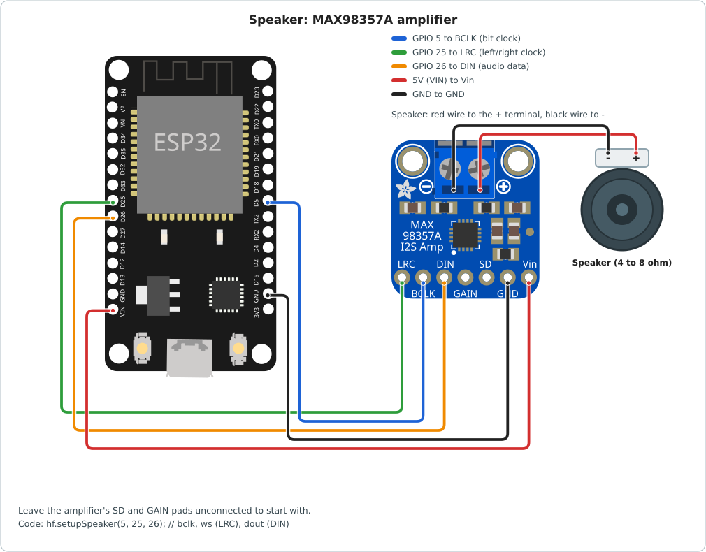
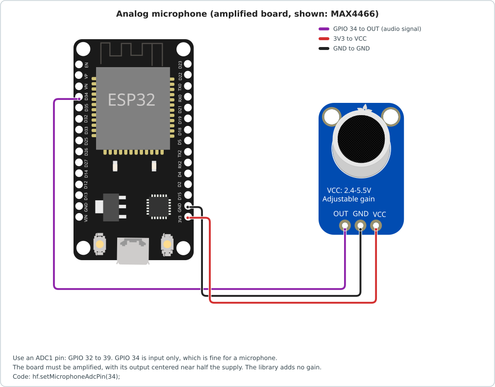
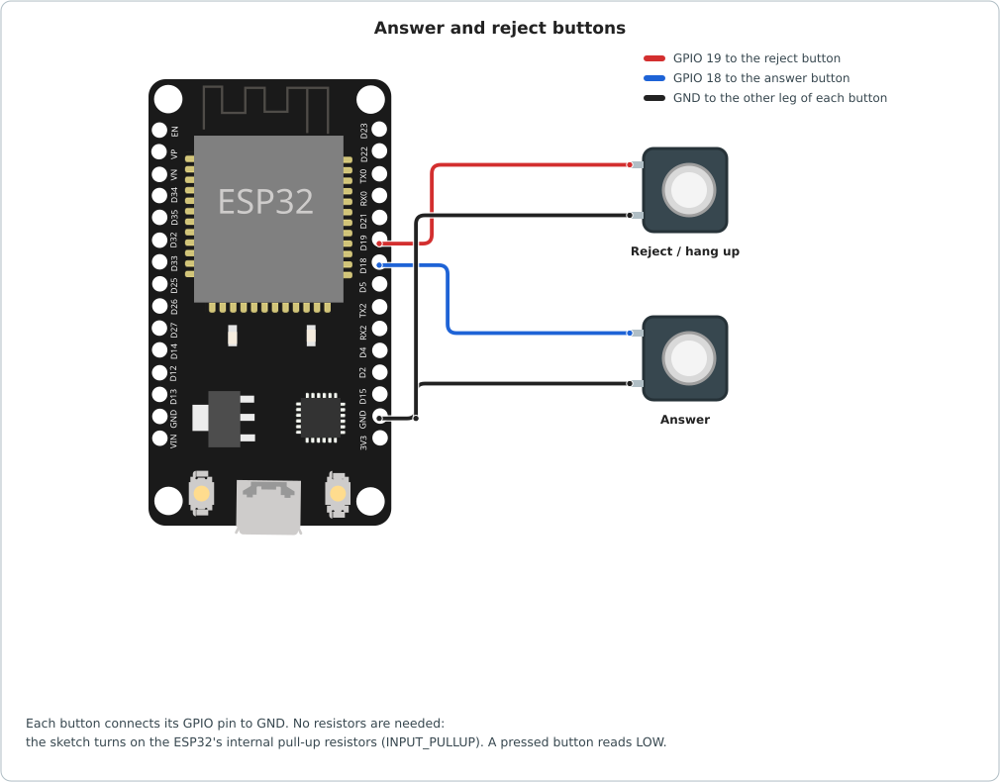
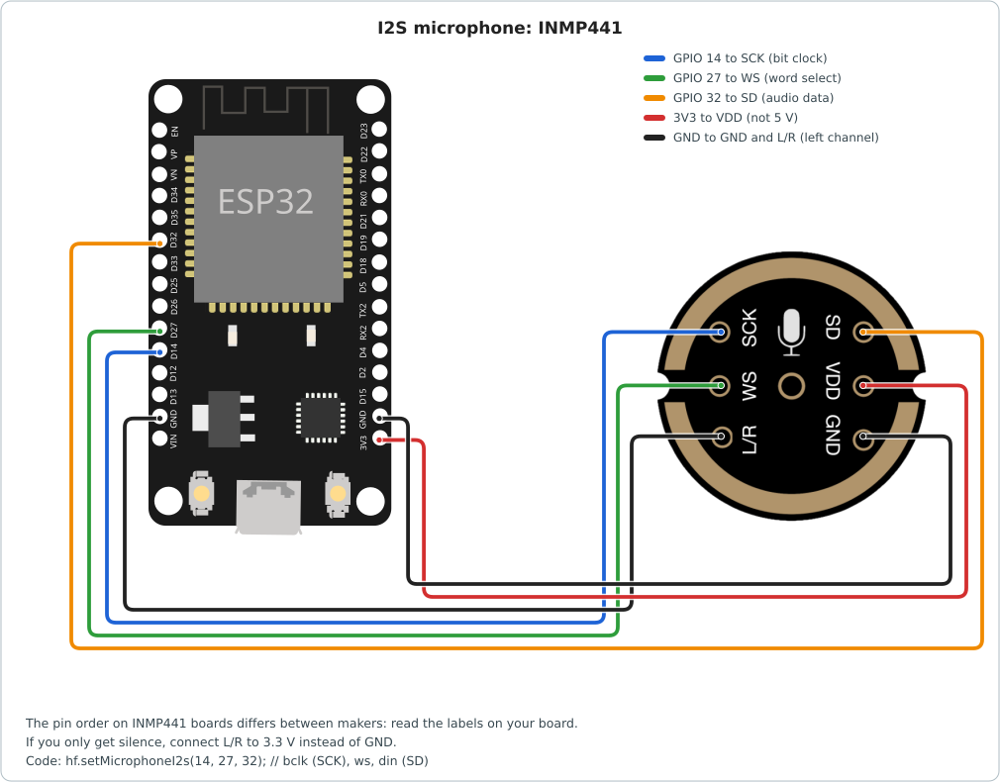
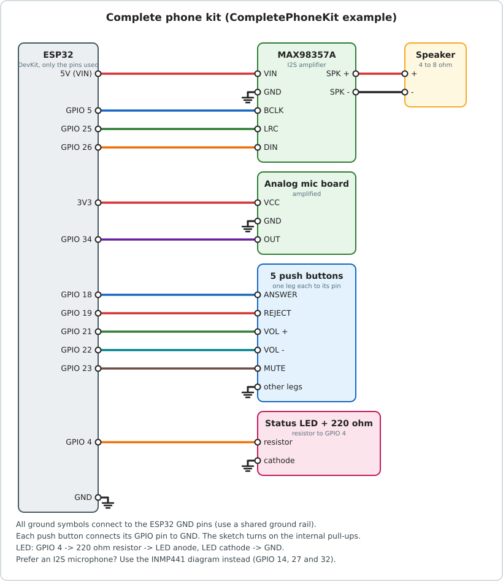
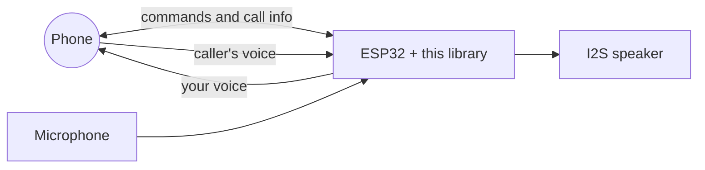
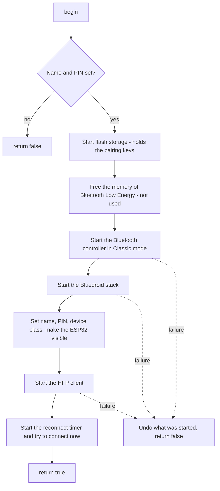

# ESP32 HFP

**A Bluetooth hands-free library.**

The ESP32 with this library behaves like the hands-free system in a car: it shows who is calling, answers and rejects calls, plays the caller's voice on a speaker, and sends your voice back through a microphone.

-blue)


**[Overview](#overview) · [Install](#install) · [Quick start](#quick-start) · [Hardware and wiring](#hardware-and-wiring) · [Using the library](#using-the-library) · [API](#api-at-a-glance) · [How it works](#how-it-works) · [Troubleshooting](#troubleshooting) · [Limitations and status](#limitations-and-status)**

## Overview

### What you can do

| | |
| --- | --- |
| **Calls** | Know about incoming and outgoing calls, with the caller's number. Answer, reject, hang up, dial, redial. |
| **Sound** | Caller's voice on an I2S speaker. Your voice from an analog or I2S microphone. Volume and mute. |
| **Phone info** | Battery level, signal strength, mobile network, the connected phone's name. |
| **Connection** | Pairs with PIN or secure pairing. Reconnects to paired phones by itself. |

### What you need

- An **original ESP32** board (ESP32 DevKit and similar). The S2, S3, C3 and C6 have no Bluetooth Classic and do NOT work.
- **Arduino-ESP32 3.x**, with PlatformIO or the Arduino IDE.
- A phone with Bluetooth.
- Optional, to talk and listen: an I2S speaker amplifier (for example **MAX98357A**) and a microphone (an amplified analog board, or an I2S one such as the **INMP441**).


## Sketch: Talk and listen

```cpp
#include <esp32_hf.hpp>

#define SPEAKER_BCLK 5
#define SPEAKER_WS 25
#define SPEAKER_DOUT 26
#define MIC_ADC_PIN 34

EspHf& hf = EspHf::getInstance();

// Callbacks run in their own tasks. Keep them short.
void onConnected() { Serial.println("Phone connected"); }
void onDisconnected() { Serial.println("Phone disconnected"); }

void onIncoming(char number[15], bool simCall)
{
    if (simCall)
        Serial.printf("Incoming call from %s\n", number);
    else
        Serial.println("Incoming call from an app");
}

void onCallEnded() { Serial.println("Call ended"); }

void setup()
{
    Serial.begin(115200);

    // Required: the name phones show, and a PIN for phones that ask for one.
    hf.setDeviceName("ESP32 Hands-Free");
    hf.setLegacyPin("1234");

    // Sound: the speaker (I2S amplifier) and the microphone (analog, on an ADC1 pin).
    if (!hf.setupSpeaker(SPEAKER_BCLK, SPEAKER_WS, SPEAKER_DOUT))
        Serial.println("Speaker setup failed");
    hf.setMicrophoneAdcPin(MIC_ADC_PIN);

    // The most useful callbacks.
    hf.setCbBtConnected(onConnected);
    hf.setCbBtDisconnected(onDisconnected);
    hf.setCbIncomingCall(onIncoming);
    hf.setCbCallEnded(onCallEnded);

    if (hf.begin())
        Serial.println("Ready. Pair 'ESP32 Hands-Free' in your phone's Bluetooth settings.");
    else
        Serial.println("Could not start the library, check the log above");
}

void loop()
{
    // Everything runs in the background.
    delay(1000);
}
```

### Wiring for the sketch

| Part | Pin | ESP32 |
| --- | --- | --- |
| MAX98357A | BCLK | GPIO 5 |
| MAX98357A | LRC | GPIO 25 |
| MAX98357A | DIN | GPIO 26 |
| MAX98357A | VIN / GND | 5 V / GND |
| Microphone board | OUT | GPIO 34 |
| Microphone board | VCC / GND | 3.3 V / GND |

<p>
<a href="docs/images/wiring-speaker.svg"></a>
<a href="docs/images/wiring-analog-mic.svg"></a>
</p>

## More examples

Each one is also a ready sketch in the [`examples/`](examples/) folder (Arduino IDE: **File > Examples > ESP32 HFP**).

<details>
<summary><b>Print calls: no extra parts</b></summary>

Only an ESP32. It pairs with a phone and prints connections and calls to the Serial Monitor. The phone sends the call sound to the ESP32, which drops it (there is no speaker), so you will not hear the caller on the phone.

```cpp
// MinimalCalls
// The simplest use of the library: pair a phone and print call events.
// No speaker or microphone is needed, only an ESP32 and the Serial Monitor (115200).
//
// Note: call audio is sent to the ESP32 and dropped here, so you will not hear the
// caller on the phone. See HandsFreeAnalogMic to actually talk.

#include <Arduino.h>
#include <esp32_hf.hpp>

EspHf& hf = EspHf::getInstance();

void onConnected() { Serial.println("Phone connected"); }
void onDisconnected() { Serial.println("Phone disconnected"); }

void onIncoming(char number[15], bool simCall)
{
    if (simCall)
        Serial.printf("Incoming call from %s\n", number);
    else
        Serial.println("Incoming call from an app (no number)");
}

void onOutgoing(char number[15], bool simCall)
{
    if (simCall)
        Serial.printf("Calling %s\n", number);
    else
        Serial.println("Calling from an app (no number)");
}

void setup()
{
    Serial.begin(115200);

    // Both are required. The PIN is used by phones that ask for one when pairing.
    hf.setDeviceName("ESP32 Hands-Free");
    hf.setLegacyPin("1234");

    hf.setCbBtConnected(onConnected);
    hf.setCbBtDisconnected(onDisconnected);
    hf.setCbIncomingCall(onIncoming);
    hf.setCbOutgoingCall(onOutgoing);

    if (!hf.begin())
        Serial.println("Could not start the library, check the log above");
    else
        Serial.println("Ready. Pair 'ESP32 Hands-Free' in your phone's Bluetooth settings.");
}

void loop()
{
    // Everything runs in the background, nothing to do here.
    delay(1000);
}
```

</details>

<details>
<summary><b>Answer and reject with buttons</b></summary>

Two buttons, each between a pin and GND. No resistors are needed: the sketch uses the internal pull-up resistors.

```cpp
// ButtonControl
// Answer and reject calls with two buttons.
//
// Wiring: button 1 between GPIO 18 and GND (answer), button 2 between GPIO 19 and GND
// (reject / hang up). The internal pull-up resistors are used, no other parts needed.
//
// Note: like MinimalCalls, this sketch has no speaker or microphone.

#include <Arduino.h>
#include <esp32_hf.hpp>

#define ANSWER_PIN 18
#define REJECT_PIN 19

EspHf& hf = EspHf::getInstance();

void onIncoming(char number[15], bool simCall)
{
    if (simCall)
        Serial.printf("Incoming call from %s. Press the answer or reject button.\n", number);
    else
        Serial.println("Incoming call from an app. Press the answer or reject button.");
}

void setup()
{
    Serial.begin(115200);
    pinMode(ANSWER_PIN, INPUT_PULLUP);
    pinMode(REJECT_PIN, INPUT_PULLUP);

    hf.setDeviceName("ESP32 Hands-Free");
    hf.setLegacyPin("1234");
    hf.setCbIncomingCall(onIncoming);

    if (!hf.begin())
        Serial.println("Could not start the library, check the log above");
}

void loop()
{
    // Buttons read LOW when pressed. Wait for release so one press sends one command.
    if (digitalRead(ANSWER_PIN) == LOW) {
        hf.acceptIncomingCall();
        while (digitalRead(ANSWER_PIN) == LOW)
            delay(10);
    }
    if (digitalRead(REJECT_PIN) == LOW) {
        hf.rejectIncomingCall(); // Also hangs up a call that is already running.
        while (digitalRead(REJECT_PIN) == LOW)
            delay(10);
    }
    delay(10);
}
```
| Button | Pin |
| --- | --- |
| Answer | GPIO 18 |
| Reject / hang up | GPIO 19 |



</details>

<details>
<summary><b>Digital I2S microphone (INMP441) instead of the analog one</b></summary>

The same hands-free as the first sketch, with a digital microphone. The microphone uses I2S port 0 and the speaker port 1, so both work together.

```cpp
// HandsFreeI2SMic
// Same as HandsFreeAnalogMic, but with a digital I2S microphone (for example an INMP441).
//
// Wiring (see the "Hardware and wiring" section of the README for details):
//   MAX98357A amp: BCLK -> GPIO 5, LRC -> GPIO 25, DIN -> GPIO 26
//   INMP441 mic:   SCK -> GPIO 14, WS -> GPIO 27, SD -> GPIO 32, L/R -> GND

#include <Arduino.h>
#include <esp32_hf.hpp>

#define SPEAKER_BCLK 5
#define SPEAKER_WS 25
#define SPEAKER_DOUT 26

#define MIC_BCLK 14
#define MIC_WS 27
#define MIC_DIN 32

EspHf& hf = EspHf::getInstance();

void onIncoming(char number[15], bool simCall)
{
    Serial.printf("Incoming call %s\n", simCall ? number : "(app call)");
}

void setup()
{
    Serial.begin(115200);

    hf.setDeviceName("ESP32 Hands-Free");
    hf.setLegacyPin("1234");

    if (!hf.setupSpeaker(SPEAKER_BCLK, SPEAKER_WS, SPEAKER_DOUT))
        Serial.println("Speaker setup failed");

    // The microphone uses I2S port 0, the library's speaker uses port 1, so both work together.
    hf.setMicrophoneI2s(MIC_BCLK, MIC_WS, MIC_DIN);

    hf.setCbIncomingCall(onIncoming);

    if (!hf.begin())
        Serial.println("Could not start the library, check the log above");
}

void loop()
{
    delay(1000);
}
```

| INMP441 | ESP32 |
| --- | --- |
| SCK | GPIO 14 |
| WS | GPIO 27 |
| SD | GPIO 32 |
| VDD | 3.3 V (not 5 V) |
| GND, L/R | GND |



</details>

<details>
<summary><b>Complete phone kit (Recommended to explore all features): buttons, volume, mute, LED and Serial commands</b></summary>

One sketch with the most important uses together: speaker, microphone, answer / redial and reject buttons, volume up and down, mute, a status LED, and Serial Monitor commands. If you want a working product rather than a demo, start from this one.



| Part | Pins |
| --- | --- |
| MAX98357A amplifier | BCLK GPIO 5, LRC GPIO 25, DIN GPIO 26, VIN 5 V, GND |
| Analog microphone board | OUT GPIO 34, VCC 3.3 V, GND (or an INMP441: set `USE_I2S_MIC` to `true`, pins 14, 27, 32) |
| Answer / redial button | GPIO 18 to GND |
| Reject / hang up button | GPIO 19 to GND |
| Volume up / down buttons | GPIO 21 / GPIO 22 to GND |
| Mute button | GPIO 23 to GND |
| Status LED | GPIO 4 to a 220 ohm resistor to the LED, LED to GND |

| You do | What happens |
| --- | --- |
| Pair the phone | Connection and pairing messages (and the 6-digit code) appear on the Serial Monitor |
| Phone rings | The LED blinks fast. The number is printed. |
| Press **Answer** while ringing | Call is answered. The LED stays on. |
| Press **Answer** when idle | Calls the last number again (redial) |
| Press **Reject** | Rejects a ringing call, or hangs up a running one |
| Press **Vol +** / **Vol -** | Speaker volume changes (remembered after a restart) |
| Press **Mute** | The other person can't hear you. Press again to unmute. |
| Type `i` in the Serial Monitor | Prints phone name, battery, signal, network, volume and state |
| Type `d0123456789` | Dials that number |

The LED shows the state: off = no phone connected, a short flash every 2 seconds = connected, fast blink = ringing or dialing, on = call in progress.

```cpp
// CompletePhoneKit
// A complete hands-free kit in one sketch. It covers the most important uses:
//
//   - pairing and connection messages
//   - hear the caller (speaker) and be heard (microphone)
//   - answer, reject, hang up and redial with buttons
//   - volume up / down and mute with buttons
//   - a status LED that shows what is going on
//   - dialing a number and reading phone information from the Serial Monitor
//
// Wiring: see the "Complete phone kit" picture in the README (docs/images/wiring-complete.svg).
//
//   MAX98357A amp:  BCLK -> GPIO 5,  LRC -> GPIO 25,  DIN -> GPIO 26
//   Analog mic:     OUT  -> GPIO 34  (or set USE_I2S_MIC to true, see below)
//   Buttons (each between its pin and GND):
//       ANSWER 18, REJECT 19, VOL+ 21, VOL- 22, MUTE 23
//   Status LED:     GPIO 4 -> 220 ohm resistor -> LED -> GND
//
// Serial Monitor (115200). Type a line and press Enter:
//   i            show phone information
//   d0123456789  dial that number

#include <Arduino.h>
#include <esp32_hf.hpp>

// ---------------- Pins ----------------
#define SPEAKER_BCLK 5
#define SPEAKER_WS 25
#define SPEAKER_DOUT 26

// Choose the microphone: analog (ADC1 pin) or digital I2S (for example INMP441).
#define USE_I2S_MIC false
#define MIC_ADC_PIN 34
#define MIC_I2S_BCLK 14
#define MIC_I2S_WS 27
#define MIC_I2S_DIN 32

#define PIN_ANSWER 18
#define PIN_REJECT 19
#define PIN_VOL_UP 21
#define PIN_VOL_DOWN 22
#define PIN_MUTE 23
#define PIN_LED 4

EspHf& hf = EspHf::getInstance();

// ---------------- A simple debounced button ----------------
// pressed() is true once for each press. Buttons connect the pin to GND (INPUT_PULLUP).
struct Button {
    uint8_t pin;
    bool last_level = HIGH;
    uint32_t last_change = 0;

    explicit Button(uint8_t p) : pin(p) {}
    void begin() { pinMode(pin, INPUT_PULLUP); }
    bool pressed()
    {
        const bool level = digitalRead(pin);
        if (level != last_level && millis() - last_change > 30) {
            last_change = millis();
            last_level = level;
            return level == LOW;
        }
        return false;
    }
};

Button answerButton(PIN_ANSWER);
Button rejectButton(PIN_REJECT);
Button volUpButton(PIN_VOL_UP);
Button volDownButton(PIN_VOL_DOWN);
Button muteButton(PIN_MUTE);

bool muted = false;

// ---------------- Callbacks ----------------
// Callbacks run in their own tasks, so they only print here. For real work, set a flag
// and handle it in loop().

void onConnected() { Serial.println("[phone] connected"); }
void onDisconnected() { Serial.println("[phone] disconnected, waiting for it to come back"); }

void onIncoming(char number[15], bool simCall)
{
    if (simCall)
        Serial.printf("[call] incoming from %s\n", number);
    else
        Serial.println("[call] incoming from an app (no number)");
}

void onOutgoing(char number[15], bool simCall)
{
    if (simCall)
        Serial.printf("[call] calling %s\n", number);
    else
        Serial.println("[call] calling from an app (no number)");
}

void onCallActive() { Serial.println("[call] active"); }
void onCallEnded() { Serial.println("[call] ended"); }
void onAudioOn() { Serial.println("[audio] sound is on the ESP32"); }
void onAudioOff() { Serial.println("[audio] sound stopped"); }

void onPairingCode(char code[7]) { Serial.printf("[pairing] code %s\n", code); }
void onPaired() { Serial.println("[pairing] done"); }
void onPairingFailed() { Serial.println("[pairing] failed"); }

// ---------------- Status LED ----------------
// off          no phone connected
// slow blink   phone connected, no call
// fast blink   phone is ringing
// on           call in progress
void updateLed()
{
    bool on = false;
    switch (hf.getState()) {
    case IDLE_DISCONNECTED:
        on = false;
        break;
    case IDLE_CONNECTED:
        on = (millis() % 2000) < 100; // short flash every 2 seconds
        break;
    case INCOMING_CALL:
    case OUTGOING_CALL:
        on = (millis() % 300) < 150; // fast blink
        break;
    case IN_CALL:
        on = true;
        break;
    }
    digitalWrite(PIN_LED, on);
}

// ---------------- Buttons ----------------
void handleButtons()
{
    if (answerButton.pressed()) {
        // The answer button answers a ringing call, or calls the last number when idle.
        if (hf.getState() == INCOMING_CALL)
            hf.acceptIncomingCall();
        else if (hf.getState() == IDLE_CONNECTED)
            hf.redial();
    }

    if (rejectButton.pressed())
        hf.endCall(); // Rejects a ringing call, or hangs up a running one.

    if (volUpButton.pressed()) {
        hf.setVolume(min(hf.getVolume() + 1, 15));
        Serial.printf("[volume] %d\n", hf.getVolume());
    }
    if (volDownButton.pressed()) {
        hf.setVolume(max(hf.getVolume() - 1, 0));
        Serial.printf("[volume] %d\n", hf.getVolume());
    }

    if (muteButton.pressed()) {
        muted = !muted;
        hf.setMicMute(muted);
        Serial.println(muted ? "[mic] muted" : "[mic] unmuted");
    }
}

// ---------------- Serial commands ----------------
void printInfo()
{
    Serial.println("---- phone information ----");
    Serial.printf("connected:   %s\n", hf.isConnected() ? "yes" : "no");
    Serial.printf("phone name:  %s\n", hf.getPeerName());
    Serial.printf("state:       %d (0 disconnected, 1 idle, 2 in call, 3 incoming, 4 outgoing)\n", hf.getState());
    Serial.printf("battery:     %d (0-5, -1 = not reported)\n", hf.getBatteryLevel());
    Serial.printf("signal:      %d (0-5, -1 = not reported)\n", hf.getSignalStrength());
    Serial.printf("network:     %s\n", hf.isNetworkAvailable() ? "yes" : "no");
    Serial.printf("volume:      %d (0-15)\n", hf.getVolume());
    Serial.printf("mic muted:   %s\n", muted ? "yes" : "no");
}

void handleSerial()
{
    if (!Serial.available())
        return;
    String line = Serial.readStringUntil('\n');
    line.trim();
    if (line.length() == 0)
        return;

    if (line == "i") {
        printInfo();
    } else if (line[0] == 'd' && line.length() > 1) {
        String number = line.substring(1);
        Serial.printf("[call] dialing %s -> %s\n", number.c_str(), hf.callNumber(number.c_str()) ? "sent" : "failed");
    } else {
        Serial.println("Commands: i (info), d<number> (dial)");
    }
}

// ---------------- Setup and loop ----------------
void setup()
{
    Serial.begin(115200);
    Serial.setTimeout(20);

    pinMode(PIN_LED, OUTPUT);
    answerButton.begin();
    rejectButton.begin();
    volUpButton.begin();
    volDownButton.begin();
    muteButton.begin();

    // Required: how phones see the kit, and the PIN for phones that ask for one.
    hf.setDeviceName("ESP32 Phone Kit");
    hf.setLegacyPin("1234");

    // Sound.
    if (!hf.setupSpeaker(SPEAKER_BCLK, SPEAKER_WS, SPEAKER_DOUT))
        Serial.println("Speaker setup failed");
    if (USE_I2S_MIC)
        hf.setMicrophoneI2s(MIC_I2S_BCLK, MIC_I2S_WS, MIC_I2S_DIN);
    else
        hf.setMicrophoneAdcPin(MIC_ADC_PIN);

    // Messages.
    hf.setCbBtConnected(onConnected);
    hf.setCbBtDisconnected(onDisconnected);
    hf.setCbIncomingCall(onIncoming);
    hf.setCbOutgoingCall(onOutgoing);
    hf.setCbCallActive(onCallActive);
    hf.setCbCallEnded(onCallEnded);
    hf.setCbAudioConnected(onAudioOn);
    hf.setCbAudioDisconnected(onAudioOff);
    hf.setCbSspAuth(onPairingCode);
    hf.setCbPinCorrect(onPaired);
    hf.setCbPinIncorrect(onPairingFailed);

    if (hf.begin())
        Serial.println("Ready. Pair 'ESP32 Phone Kit' in your phone's Bluetooth settings.");
    else
        Serial.println("Could not start the library, check the log above");
}

void loop()
{
    handleButtons();
    handleSerial();
    updateLed();
    delay(5);
}
```

How the sketch is built:

| Part of the sketch | What it does |
| --- | --- |
| `Button` | A tiny helper that debounces a button. `pressed()` is true once for each press. |
| Callbacks (`onConnected`, `onIncoming`, ...) | Print what happens. They run in their own tasks, so they only print. |
| `updateLed()` | Reads `hf.getState()` and sets the LED. |
| `handleButtons()` | Turns button presses into library calls: `acceptIncomingCall`, `redial`, `endCall`, `setVolume`, `setMicMute`. |
| `handleSerial()` | Reads `i` and `d<number>` from the Serial Monitor. |
| `setup()` | Names the kit, sets up the speaker and microphone, registers the callbacks, calls `begin()`. |
| `loop()` | Runs the three handlers. All the Bluetooth work happens in the background. |

> The pins GPIO 21, 22, 23 and 4 are not tested on real hardware yet. Check them against your board.

</details>


## Install

**PlatformIO** (`platformio.ini`):

```ini
[env:esp32dev]
platform = https://github.com/pioarduino/platform-espressif32/releases/download/stable/platform-espressif32.zip#5.5.5
board = esp32dev
framework = arduino
monitor_speed = 115200
lib_deps =
    https://github.com/ChickenWithRiceW/esp32_hf.git
```

The `platform` line gives you Arduino-ESP32 3.x. The library was developed with this exact version.

**Arduino IDE:** install *esp32 by Espressif Systems* version 3.x in the Boards Manager, download this repository as a `.zip`, then **Sketch > Include Library > Add .ZIP Library**. Examples appear under **File > Examples > ESP32 HFP**.

A sketch using the library is about 1.1 MB. That fits the default partition scheme, but only just. If the upload says the sketch is too big, choose a partition scheme with more app space (for example "Huge APP").

## Quick start

### The rules in one minute

1. Set everything up **before** `begin()`: name, PIN, speaker, microphone.
2. A device name and a PIN are required.
3. Call `begin()` once.
4. Callbacks run in their own tasks, at the same time as `loop()`. Keep them short.
5. After `begin()` the ESP32 can be found and paired by phones, and it reconnects to paired phones by itself.

## Hardware and wiring

You do not need extra parts to see calls and to answer or reject them. You only need parts to **hear** the caller and to **talk**.

| You want to... | You need |
| --- | --- |
| Watch calls, answer, reject, dial | Just the ESP32 |
| Hear the caller | An I2S speaker amplifier and a speaker |
| Be heard | A microphone (analog or I2S) |


### Pins to avoid and power

- GPIO 6 to 11 are connected to the flash memory. Never use them.
- GPIO 0, 2, 5, 12 and 15 are read when the chip starts. A wrong level at that moment can stop the ESP32 from booting. GPIO 5 is used for the speaker in the examples and works on most boards. If yours doesn't start with the amplifier connected, try another pin.

## Using the library

The full list of functions is in the **[API documentation](docs/API.md)**. This section shows how the parts fit together.

### The usual order

```cpp
EspHf& hf = EspHf::getInstance();   // Get the library (there is only one)

void setup() {
    hf.setDeviceName("My Kit");         // Set device name you will see on bluetooth.
    hf.setLegacyPin("1234");            // Set legacy pin for bluetooth connecting.
    hf.setupSpeaker(5, 25, 26);         // Setup speaker by giving in used pins.
    hf.setMicrophoneAdcPin(34);         // Setup analog microphone with dedicated pin.
    hf.setCbIncomingCall(onIncoming);   // Setup which function will be called when there is a incoming call.

    hf.begin();                     // Start it. Once.
}
```

After `begin()`, you can change most settings on runtime but most will only update when you reconnect to the esp32. Callbacks can be changed at any time with instant update.

If `begin()` returns `false`, the name or PIN is missing, or Bluetooth could not start. The log says which. After a failed `begin()` the library cleans up, so you can fix the problem and call `begin()` again.

### Pairing

After `begin()` the ESP32 is visible to every phone nearby. To pair, open the phone's Bluetooth settings and tap its name. There are two styles, and the phone picks:

- **Secure pairing (default).** The phone shows a 6-digit code. The ESP32 accepts it automatically. To see the code on the ESP32 side, use `setCbSspAuth()`.
- **PIN pairing.** The phone asks for the PIN you set. Phones use this when secure pairing is off, or when your phone is old. Force pin paring with `hf.setSecurePairing(false)`.

Use `setCbPinCorrect()` and `setCbPinIncorrect()` to be told how pairing went. The pairing is stored in flash, so it survives a restart.

> Any phone in range can pair with the ESP32. There is no pairing button yet.

## API at a glance

Every function on one page. The full description of each one, with parameters, return values and rules, is in the **[API documentation](docs/API.md)**.
```cpp
// Setup, before begin()
hf.setDeviceName("Kit");                hf.setLegacyPin("1234");                hf.setSecurePairing(true);
hf.setupSpeaker(bclk, ws, dout);
hf.setMicrophoneAdcPin(pin);            hf.setMicrophoneI2s(bclk, ws, din);
hf.begin();

// Calls
hf.acceptIncomingCall();                hf.rejectIncomingCall();                hf.endCall();
hf.callNumber("0123456789");            hf.redial();

// Sound
hf.setVolume(0..15);    hf.setMicMute(true);    hf.connectAudio();    hf.disconnectAudio();

// Information
hf.getState();              hf.isConnected();           hf.getPeerName();
hf.getBatteryLevel();       hf.getSignalStrength();     hf.isNetworkAvailable();    hf.getVolume();

// Callbacks
hf.setCbIncomingCall(f);    hf.setCbOutgoingCall(f);    hf.setCbCallActive(f);      hf.setCbCallEnded(f);
hf.setCbBtConnected(f);     hf.setCbBtDisconnected(f);
hf.setCbAudioConnected(f);  hf.setCbAudioDisconnected(f);
hf.setCbPinCorrect(f);      hf.setCbPinIncorrect(f);    hf.setCbSspAuth(f);         hf.setCbLegacyAuth(f);
```
## How it works

You do not need this section to use the library. Read it if you are curious, or if something behaves in a way you don't expect.

### The two sides

The Hands-Free Profile (HFP) has two roles. The **Audio Gateway** is the phone: it owns the calls and the mobile network. The **Hands-Free unit** is the ESP32: it shows call information and carries the sound. The ESP32 never makes a call itself. It sends short commands ("answer", "dial this number") and the phone does the work and reports back.



There are two links between them: a **control link** for commands and reports, and an **audio link** that exists only while sound is moving.

### Start-up



The ESP32 announces itself as an audio device with the telephony service, which is what makes phones offer it for calls.

### The audio link

Call sound is sent as small digital frames, 16-bit mono. The phone and ESP32 agree on one of two formats when the audio link opens:

| Format | Quality | Sample rate | Frame size |
| --- | --- | --- | --- |
| CVSD | Narrow-band (older) | 8,000 per second | 60 bytes |
| mSBC | Wide-band (clearer) | 16,000 per second | 240 bytes |

Most modern phones pick mSBC. The library supports both and sets the speaker's sample rate to match each call. *The 8 kHz path is untested on hardware.*

- **Speaker:** each frame from the phone is made quieter by the volume setting, `(volume / 15)²`, which feels more natural than a straight line. It is then written to the I2S speaker.
- **Microphone:** a small task records while call audio is connected and puts finished frames into a queue of two. The Bluetooth stack takes a frame whenever it wants one. If the queue is empty nothing is sent for that moment, and if it is full the new frame is dropped.
  - *I2S microphone:* reads 32-bit samples and keeps the top 16 bits.
  - *Analog microphone:* the ADC samples at 32,000 per second and the task averages groups of samples down to 16,000 or 8,000. It centers the sound (2048 of 4096) and scales it to 16 bits. It adds no gain.
  - *Mute:* replaces each frame with silence.

### Tasks and memory

| Where | What runs there |
| --- | --- |
| Your `loop()` | Your code |
| Bluetooth task | The library's event handling (calls, connecting, speaker audio) |
| Timer task | The reconnect check, every 5 seconds |
| Callback tasks | One short task for each callback, created and deleted on the fly |
| Microphone task | Records while call audio is connected |

Each callback gets its own copy of its data, deleted when the callback ends, so two events close together can't overwrite each other. The memory of Bluetooth Low Energy is given back at start-up. Pairing keys and the saved volume live in flash (NVS). A typical sketch uses about 1.1 MB of flash and 43 KB of RAM. (NEEDS MORE TESTING)

## Limitations and status

### Limitations

- **Original ESP32 only.** Other ESP32 chips have no Bluetooth Classic.
- **Arduino-ESP32 3.x.** Plain ESP-IDF is not supported yet.
- **One phone at a time.** Several can be paired, but only one is connected.
- **Calls only.** No music (A2DP).
- **No raw AT commands.** The ESP32's Bluetooth code only allows its own command functions. The common ones are available as functions.
- **No DTMF tones, no call waiting or hold control.**
- **Phone numbers** can have up to 15 digits (plus a leading `+`). Longer numbers are cut off.
- **Calls that don't come over the SIM card** (for example Signal) are not handled correctly yet. The call direction and state are not reliable for them.
- **Pairing is open.** Any phone in range can pair. There is no pairing button.
- **No microphone gain.** The microphone must give a good signal.
- **Settings are fixed after `begin()`.** Name, PIN and audio can't be changed without a restart.
- **Volume** can't be read from the phone. The library remembers the last volume it was told.

### Status: what is tested

The core works on real hardware: pairing, incoming, outgoing and app calls, wide-band audio with speaker and analog microphone, and volume. These newer parts are written and compile, but are **not tested on hardware yet**:

- reconnecting after the phone went out of range, and with several paired phones
- mute, and moving call audio with `connectAudio()` / `disconnectAudio()`
- the 8 kHz (narrow-band) call format
- the call active/ended and audio callbacks
- `getPeerName()`, `getBatteryLevel()` and `getSignalStrength()` on different phones
- `begin()` failing and being called again

If one of these misbehaves for you, please open an issue with the Serial Monitor log.

## License

The library and examples are **MIT**. See [LICENSE](LICENSE).

### Picture credits

The wiring pictures use real part artwork, stored in [`docs/images/parts/`](docs/images/parts/CREDITS.md):

- ESP32 DevKit V1 picture: [wokwi-elements](https://github.com/wokwi/wokwi-elements) by Uri Shaked (MIT).
- MAX98357A and MAX4466 pictures: [Adafruit Fritzing Library](https://github.com/adafruit/Fritzing-Library) (CC BY-SA 3.0). The two wiring pictures that contain them, `wiring-speaker.svg` and `wiring-analog-mic.svg`, are therefore also shared under [CC BY-SA 3.0](https://creativecommons.org/licenses/by-sa/3.0/).
- The INMP441 picture was supplied by the project maintainer. Its license is still to be confirmed (see [`parts/CREDITS.md`](docs/images/parts/CREDITS.md)).
- The speaker and push buttons are simple illustrations made for this project.

The pictures are generated by [`docs/images/generate_wiring.py`](docs/images/generate_wiring.py).
