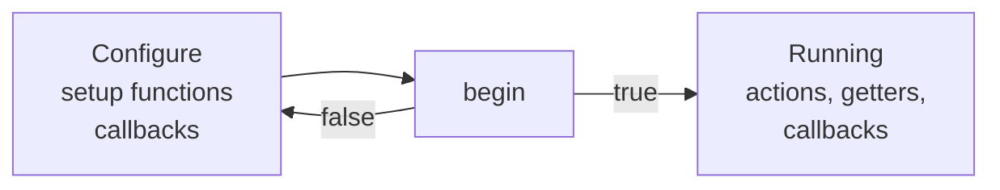
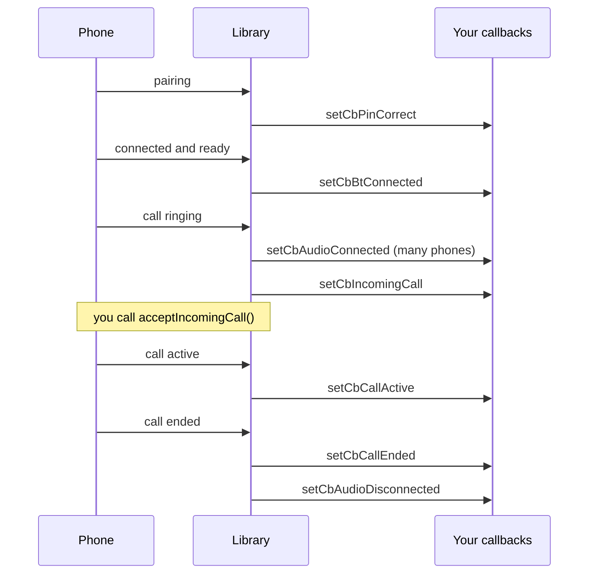

# API documentation

This is the complete reference for **ESP32 HFP**. For an introduction, wiring and examples, start with the [README](../README.md).

- [Conventions](#conventions)
- [Lifecycle](#lifecycle)
- [Types](#types)
- [Getting the library](#getting-the-library)
- [Start](#start)
- [Setup functions](#setup-functions)
- [Callbacks](#callbacks)
- [Actions](#actions)
- [Getters](#getters)
- [Limits and constants](#limits-and-constants)
- [Threads and timing](#threads-and-timing)
- [Logging](#logging)

```cpp
#include <esp32_hf.hpp>
```

## Conventions

- Almost every function returns `bool`. `true` means success. `false` means it failed, and a message in the log says why.
- Strings you pass in are **copied**. They may go out of scope afterwards.
- Functions marked *Untested* work as designed in the code but have not been tried on real hardware yet.

## Lifecycle



1. **Configure.** Call the setup functions. Set callbacks.
2. **`begin()`.** Starts Bluetooth. On failure it undoes what it started, and you can fix the cause and call it again.
3. **Running.** Actions and getters work. The library connects to paired phones, runs the call logic and fires callbacks.

There is no `end()`. To change a setting that is fixed after `begin()`, restart the ESP32.

## Types

### `e_state`

```cpp
enum e_state {
    IDLE_DISCONNECTED = 0,  // No phone connected.
    IDLE_CONNECTED,         // Phone connected, no call.
    IN_CALL,                // A call is active.
    INCOMING_CALL,          // The phone is ringing.
    OUTGOING_CALL,          // A call is being placed.
};
```

The state follows the call signals of the phone. It does not depend on whether call audio is connected. If a call is waiting while another is active, the state shows the ringing call (`INCOMING_CALL`).

## Getting the library

### `getInstance`

```cpp
static EspHf& EspHf::getInstance();
```

Returns the only instance of the library. Keep a reference at file level:

```cpp
EspHf& hf = EspHf::getInstance();
```

The object cannot be copied. It lives for the whole program.

## Start

### `begin`

```cpp
bool begin();
```

Starts flash storage, the Bluetooth controller (Classic mode), the Bluedroid stack and the HFP client. It then makes the ESP32 visible to phones, and starts connecting to paired phones.

**Returns** `true` when everything started. `false` when:

- `begin()` was already called successfully,
- the device name or the PIN is not set,
- or a Bluetooth step failed (the log names it).

**Notes**

- Call it once, after the setup functions.
- After a `false`, everything that was started is stopped again, so you can call `begin()` again.
- It takes a short moment. Callbacks may fire before it returns.

## Setup functions

All setup functions must be called **before `begin()`**.

### `setDeviceName`

```cpp
bool setDeviceName(const char* device_name);
```

Sets the name phones show in their Bluetooth list. **Required.**

| Parameter | Description |
| --- | --- |
| `device_name` | Printable characters, not empty, at most 248 bytes. Copied. |

**Returns** `false` for a null, empty, too long or non-printable name, or if `begin()` was already called.

### `setLegacyPin`

```cpp
bool setLegacyPin(const char* legacy_pin);
```

Sets the PIN used for PIN pairing. **Required**, even if you use secure pairing, because older phones fall back to it.

| Parameter | Description |
| --- | --- |
| `legacy_pin` | 1 to 16 printable characters. Copied. |

**Returns** `false` for a null, empty, too long or non-printable PIN, or if `begin()` was already called.

### `setSecurePairing`

```cpp
bool setSecurePairing(bool enable_ssp);
```

Turns Secure Simple Pairing (SSP) on or off. **On by default.**

- **On:** the phone shows a 6-digit code. The ESP32 confirms it automatically and reports the code through [`setCbSspAuth`](#setcbsspauth).
- **Off:** phones must pair with the PIN.

**Returns** `false` if `begin()` was already called.

### `setupSpeaker`

```cpp
I2SClass* setupSpeaker(int8_t bclk, int8_t ws, int8_t dout,
                       int8_t din = -1, int8_t mclk = -1);
```

Sets up a speaker on **I2S port 1** and starts it: standard I2S, 16-bit, mono, 16 kHz at first. The library changes the sample rate to match each call (see [`setSpeakerI2s`](#setspeakeri2s)).

| Parameter | Description |
| --- | --- |
| `bclk` | Bit clock pin |
| `ws` | Word select (left/right clock) pin |
| `dout` | Data out pin, to the amplifier |
| `din` | Data in pin, `-1` if not used |
| `mclk` | Master clock pin, `-1` if not used |

**Returns** the I2S object, or `nullptr` if the speaker could not start (or `begin()` was already called). You normally do not need the returned object (Could use it for own audio functions tho). Call it once.

```cpp
if (!hf.setupSpeaker(5, 25, 26))
    Serial.println("Speaker setup failed");
```

### `setSpeakerI2s`

```cpp
bool setSpeakerI2s(I2SClass* speaker);
```

Uses an I2S object that you set up yourself, instead of `setupSpeaker()`. If you call both, the last one wins.

Requirements for your object:

- It is already started with `setPins()` and `begin()`.
- It is **16-bit, mono**. The library writes 16-bit mono audio to it.
- It stays alive while the library runs (a global variable).
- If you also use a microphone, it must **not** use I2S port 0.

The library changes the **sample rate** of the object to match each call: 16,000 Hz for wide-band (mSBC), 8,000 Hz for narrow-band (CVSD). So the rate you start it with does not matter.

**Returns** `false` for a null pointer, a port 0 conflict with the microphone, or if `begin()` was already called.

```cpp
I2SClass speaker(I2S_NUM_1);

void setup() {
    speaker.setPins(5, 25, 26);
    speaker.begin(I2S_MODE_STD, 16000, I2S_DATA_BIT_WIDTH_16BIT, I2S_SLOT_MODE_MONO);
    hf.setSpeakerI2s(&speaker);
}
```

### `setMicrophoneAdcPin`

```cpp
bool setMicrophoneAdcPin(uint8_t pin);
```

Uses an **analog microphone** on the ESP32's ADC. Uses I2S port 0 internally. Recording starts when call audio connects and stops when it ends.

| Parameter | Description |
| --- | --- |
| `pin` | An ADC1 pin: GPIO 32 to 39 |

**Requirements for the signal:** amplified, and centered around half the supply voltage (about 1.65 V). The library adds no gain.

**Returns** `false` for a pin outside 32 to 39, a speaker already on I2S port 0, or if `begin()` was already called.

If you call both microphone functions, the last one wins.

### `setMicrophoneI2s`

```cpp
bool setMicrophoneI2s(int8_t bclk, int8_t ws, int8_t din, int8_t mclk = -1);
```

Uses a **digital I2S microphone** on **I2S port 0**. It is read as 32-bit mono, and the top 16 bits are used. Recording starts when call audio connects, at the sample rate of the call.

| Parameter | Description |
| --- | --- |
| `bclk` | Bit clock pin (must be 0 or higher) |
| `ws` | Word select pin (must be 0 or higher) |
| `din` | Data pin from the microphone (must be 0 or higher) |
| `mclk` | Master clock pin, `-1` if not used |

**Returns** `false` for an invalid pin, a speaker already on I2S port 0, or if `begin()` was already called.

## Callbacks

You can set and replace callbacks **at any time**, before or after `begin()`. Passing `nullptr` is refused (the function returns `false`). A callback you never set is simply not called. To stop reacting, set a function that does nothing.

Every callback runs in **its own short task**, at the same time as `loop()`. See [Threads and timing](#threads-and-timing).

### Overview

| Function | Callback signature | Fires when |
| --- | --- | --- |
| [`setCbBtConnected`](#setcbbtconnected) | `void f()` | A phone is connected and ready |
| [`setCbBtDisconnected`](#setcbbtdisconnected) | `void f()` | A connected phone is gone |
| [`setCbIncomingCall`](#setcbincomingcall) | `void f(char number[15], bool simCall)` | A call comes in |
| [`setCbOutgoingCall`](#setcboutgoingcall) | `void f(char number[15], bool simCall)` | A call is placed |
| [`setCbCallActive`](#setcbcallactive) | `void f()` | A call becomes active |
| [`setCbCallEnded`](#setcbcallended) | `void f()` | An active call ends |
| [`setCbAudioConnected`](#setcbaudioconnected) | `void f()` | Call sound starts |
| [`setCbAudioDisconnected`](#setcbaudiodisconnected) | `void f()` | Call sound stops |
| [`setCbPinCorrect`](#setcbpincorrect) | `void f()` | Pairing worked |
| [`setCbPinIncorrect`](#setcbpinincorrect) | `void f()` | Pairing failed |
| [`setCbSspAuth`](#setcbsspauth) | `void f(char code[7])` | Secure pairing code is available |
| [`setCbLegacyAuth`](#setcblegacyauth) | `void f()` | A phone asked for the PIN |

All the `setCb...` functions return `true` on success and `false` for `nullptr`.

### `setCbBtConnected`

```cpp
bool setCbBtConnected(void (*ptr)(void));
```

Fires when a phone is **connected and ready** for commands. This is later than the first radio link: the library waits until the phone has finished its set-up and told the ESP32 its current values. After this callback, the actions work.

### `setCbBtDisconnected`

```cpp
bool setCbBtDisconnected(void (*ptr)(void));
```

Fires when a phone that was connected is gone (out of range, Bluetooth switched off, or disconnected). It does **not** fire for connection attempts that never succeeded. The library starts trying to reconnect by itself.

### `setCbIncomingCall`

```cpp
bool setCbIncomingCall(void (*ptr)(char phone_number[15], bool sim_call));
```

Fires when a call comes in. It normally fires once per call, after the number is known.

| Argument | Description |
| --- | --- |
| `phone_number` | The caller's number as text, cut off after 19 characters. Empty for app calls. Valid **only during the callback**: copy it if you need it later. |
| `sim_call` | `true` for a normal phone call. `false` for a call from an app (WhatsApp, Teams, ...), which has no number. |

The declared size `[15]` is historic. The buffer holds up to 19 characters plus the end marker, and the argument is passed as a normal `char*`.

### `setCbOutgoingCall`

```cpp
bool setCbOutgoingCall(void (*ptr)(char phone_number[15], bool sim_call));
```

Fires when a call is placed, from the phone or with [`callNumber`](#callnumber) or [`redial`](#redial). The arguments are the same as for incoming calls, with the dialed number.

### `setCbCallActive`

```cpp
bool setCbCallActive(void (*ptr)(void));
```

Fires when a call becomes active: you answered, or the other side picked up. *Untested.*

### `setCbCallEnded`

```cpp
bool setCbCallEnded(void (*ptr)(void));
```

Fires when a call that was **active** ends. It does **not** fire for a call that was rejected, missed or cancelled before it became active. For those, watch [`getState`](#getstate) go back to `IDLE_CONNECTED`. *Untested.*

### `setCbAudioConnected`

```cpp
bool setCbAudioConnected(void (*ptr)(void));
```

Fires when the call sound starts to flow to the ESP32, so the speaker and microphone are in use. Many phones do this as soon as a call starts ringing, before it is answered. *Untested.*

### `setCbAudioDisconnected`

```cpp
bool setCbAudioDisconnected(void (*ptr)(void));
```

Fires when the call sound stops. It also fires if the phone disconnects while sound was flowing. *Untested.*

### `setCbPinCorrect`

```cpp
bool setCbPinCorrect(void (*ptr)(void));
```

Fires when pairing with a phone succeeded (with a PIN or with secure pairing).

### `setCbPinIncorrect`

```cpp
bool setCbPinIncorrect(void (*ptr)(void));
```

Fires when pairing failed, for example because of a wrong PIN or because the phone cancelled.

### `setCbSspAuth`

```cpp
bool setCbSspAuth(void (*ptr)(char[7]));
```

Fires during secure pairing with the 6-digit confirmation code as text (for example `"482913"`). The ESP32 confirms the pairing **automatically**, so this callback is for showing the code (on a display, in the log). It does not let you accept or refuse.

### `setCbLegacyAuth`

```cpp
bool setCbLegacyAuth(void (*ptr)(void));
```

Fires when a phone asks for the PIN. The PIN you set is sent automatically.

### Order of events

A typical sequence (the exact order depends on the phone):



## Actions

All actions need **`begin()`** to have run, otherwise they return `false`. They send a command to the phone and **return `true` as soon as the command is sent**. That does not prove the phone did it. Watch the callbacks or [`getState`](#getstate) for the result. Sending a command when it does not apply (for example answering when nothing rings) is harmless.

### `acceptIncomingCall`

```cpp
bool acceptIncomingCall(void);
```

Answers the ringing call.

### `rejectIncomingCall`

```cpp
bool rejectIncomingCall(void);
```

Rejects a ringing call. Also hangs up an outgoing or active call, because the phone treats both as the same command.

### `endCall`

```cpp
bool endCall(void);
```

The same as `rejectIncomingCall()`. Use whichever name reads better.

### `callNumber`

```cpp
bool callNumber(const char* phone_number);
```

Dials a number through the phone.

| Parameter | Description |
| --- | --- |
| `phone_number` | Digits, optionally with a leading `+`. Must not be empty. |

**Returns** `false` for a null or empty number, or if `begin()` was not called.

### `redial`

```cpp
bool redial(void);
```

Calls the last dialed number again.

### `setVolume`

```cpp
bool setVolume(int volume);
```

Sets the **speaker** volume from 0 (quiet) to 15 (loud).

What it does:

1. Changes the loudness of the ESP32 speaker. The sound is scaled by `(volume / 15)²`.
2. Saves the value in flash, so it is used after a restart.
3. Tells the phone, if one is connected.

It also works with no phone connected (then only steps 1 and 2 happen).

**Returns** `false` for a value outside 0 to 15, or if `begin()` was not called, or if a phone is connected and the command to it failed.

The phone can't be asked for its volume. The library tracks it from what the phone reports and from what you set. Before any value is known, it uses 15.

### `setMicMute`

```cpp
bool setMicMute(bool mute);
```

Mutes (`true`) or unmutes (`false`) the microphone. While muted, the other person hears silence. The setting stays until you change it, also for later calls. It has no effect when no microphone is set up. *Untested.*

Always returns `true`. It can be called at any time.

### `connectAudio`

```cpp
bool connectAudio(void);
```

Asks the phone to send the call sound to the ESP32 (speaker and microphone). Needs a connected phone.

**Returns** `false` if `begin()` was not called, no phone is connected, or the request failed. *Untested.*

### `disconnectAudio`

```cpp
bool disconnectAudio(void);
```

Asks the phone to take the call sound back. Needs a connected phone. The same return values as `connectAudio()`. *Untested.*

## Getters

Getters do not need `begin()`. Before `begin()` they return their defaults (disconnected, `-1`, empty, volume 15).

### `getState`

```cpp
e_state getState(void);
```

Returns the current [`e_state`](#e_state).

### `isConnected`

```cpp
bool isConnected(void);
```

`true` while a phone is connected and ready (between the connected and disconnected callbacks).

### `getBatteryLevel`

```cpp
int getBatteryLevel(void);
```

The phone's battery level from 0 (empty) to 5 (full), or `-1` if the phone has not reported it. Resets to `-1` when the phone disconnects. *Untested on different phones.*

### `getSignalStrength`

```cpp
int getSignalStrength(void);
```

The phone's mobile signal from 0 to 5, or `-1` if not reported. Resets to `-1` when the phone disconnects. *Untested on different phones.*

### `isNetworkAvailable`

```cpp
bool isNetworkAvailable(void);
```

`true` when the phone says it has mobile network service. `false` when it has none, or when no phone is connected.

### `getPeerName`

```cpp
const char* getPeerName(void);
```

The name of the connected phone, as the phone calls itself. Empty (`""`) when no phone is connected or the name has not arrived yet (it is requested right after the phone connects). The pointer stays valid, but the text changes when phones connect or disconnect. Copy it if you need to keep it.

### `getVolume`

```cpp
int getVolume(void);
```

The current speaker volume, 0 to 15.

## Limits and constants

| What | Value |
| --- | --- |
| Device name | 1 to 248 printable characters |
| PIN | 1 to 16 printable characters |
| Volume | 0 to 15 |
| Phone number in callbacks | up to 19 characters, then cut off |
| Secure pairing code | 6 digits (`char[7]` with the end marker) |
| Battery level, signal strength | 0 to 5, `-1` = not reported |
| Analog microphone pins | GPIO 32 to 39 (ADC1) |
| Speaker I2S port | 1 |
| Microphone I2S port | 0 |
| Speaker format | 16-bit mono, 16 kHz (wide-band) or 8 kHz (narrow-band) |
| Reconnect interval | 5 seconds, trying the next paired phone each time |
| Callback task stack | about 4 KB |

## Threads and timing

The library works in several tasks at once:

| Task | Runs |
| --- | --- |
| Your `loop()` | Your code and the actions/getters you call |
| Bluetooth task | Handling of events from the phone, speaker audio |
| Timer task | The reconnect check |
| Callback tasks | One short task per callback call. Created for the call and deleted afterwards |
| Microphone task | Recording, only while call audio is connected |

What this means for you:

- **Callbacks run at the same time as `loop()`.** If a callback and `loop()` use the same variable, use `volatile` for simple flags and a mutex for larger data.
- **Callbacks must be short.** Do not wait for a long time inside them. They have about 4 KB of stack, so avoid large arrays.
- **Callback data is private to the call.** Each call of a callback gets its own copy of its arguments, which is freed when it returns. Copy `phone_number` if you need it later.
- **Callbacks of one kind can overlap.** If two events happen close together, two callback tasks may run at once.
- **Getters read live values.** They are not locked. A single number or flag is fine. `getPeerName()` can show a half-updated name for a moment when a phone connects or disconnects.

A simple and safe pattern is to set a flag in the callback and act on it in `loop()`:

```cpp
volatile bool ringing = false;
void onIncoming(char number[15], bool simCall) { ringing = true; }

void loop() {
    if (ringing) { ringing = false; /* react */ }
}
```

## Logging

The library logs through the ESP-IDF log system, with these tags:

| Tag | Part |
| --- | --- |
| `BT_HF_HF` | Start-up and shutdown |
| `BT_HF_GAP` | Pairing and reconnecting |
| `BT_HF` | Events from the phone (calls, signal, battery) |
| `BT_HF_AUDIO` | Speaker and microphone |
| `BT_HF_GAP_SETTER` | Setup function errors |

Enable it with `-DCORE_DEBUG_LEVEL=5` in PlatformIO (`build_flags`), or **Tools > Core Debug Level > Verbose** in the Arduino IDE. Setup mistakes (wrong order, bad values) are reported as errors in the log.
